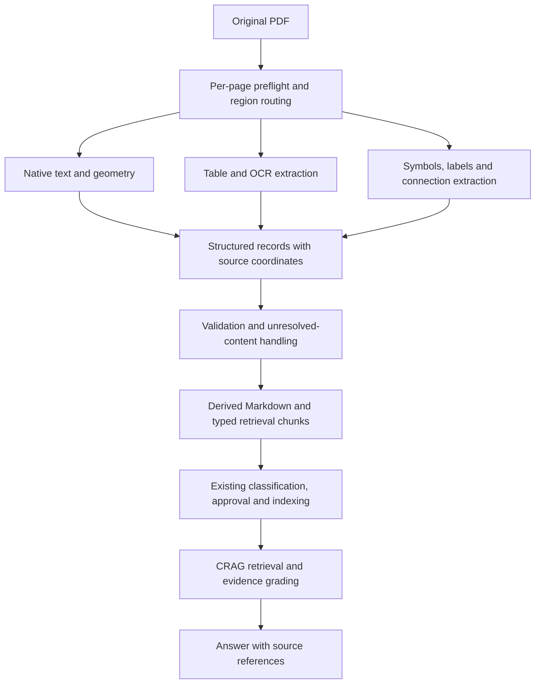

# Local extraction of engineering PDFs on an RTX 2000 Ada 8GB

Research timestamp: 2026-11-15 10:47 Asia/Bangkok.

Recommendation updated: 2026-11-15, incorporating the detailed integration and model-selection discussion. This update records the proposed architecture; it does not authorize or claim implementation.

Status: research recommendation, not an implemented or benchmark-validated design. No candidate model was installed or run. The user's constraints are local processing and an RTX 2000 Ada 8GB; host inspection confirmed an NVIDIA RTX 2000 Ada Generation Laptop GPU with 8,188 MiB. Digital versus scanned document mix is unresolved.

## Contents

- [Recommendation](#recommendation)
- [What is failing today](#what-is-failing-today)
- [Model shortlist and evidence](#model-shortlist-and-evidence)
- [Routes for each document type](#routes-for-each-document-type)
- [Proposed extraction and retrieval contract](#proposed-extraction-and-retrieval-contract)
- [Applying the architecture to the current pipeline](#applying-the-architecture-to-the-current-pipeline)
- [Operating within 8GB](#operating-within-8gb)
- [Evaluation and acceptance](#evaluation-and-acceptance)
- [Phased implementation recommendation](#phased-implementation-recommendation)
- [Trade-offs](#trade-offs)
- [Next steps and unresolved questions](#next-steps-and-unresolved-questions)

## Recommendation

Build a page/region router with two extraction families: table reconstruction and diagram reconstruction. Start evaluation with PaddleOCR-VL-1.6 and MinerU2.5-Pro for OCR/tables, retain GLM-OCR as a compact alternative, and evaluate quantized Qwen3-VL-4B for narrow visual interpretation tasks. P&ID symbol detection and connection tracing need separate components and separate correctness measurements.

Do not assign five always-resident models to five file labels. One OCR model may serve I/O lists, matrices, legends, and instrument labels. A mixed PDF can require several methods on the same page. Choose the smallest set that wins on representative documents.

**Recommended model arrangement:** use PaddleOCR-VL-1.6 as the initial primary OCR/table candidate, benchmark MinerU2.5-Pro against it, and select one as the default from measured results. Keep GLM-OCR as an alternative if accuracy or memory targets are missed. Add quantized Qwen3-VL-4B only for bounded visual interpretation where it demonstrates an improvement. Diagram routes add suitable symbol detection and geometry/connection processing; they do not require a separate general VLM for every file type. This is a small multi-model pipeline with sequential execution, not a single universal model or five permanently loaded models.

The target is correct engineering facts with source evidence. Structured JSON retains cells, terminals, and connections; Markdown is a derived retrieval view. This is an extension of the existing pipeline, with current Docling retained as a measured baseline.

**Outcome:** accurate answers about tags, I/O assignments, cause/effect relationships, and evidenced connections.

**Constraints:** local processing, 8GB VRAM, repository-local artifacts, existing ingestion cancellation and cross-store consistency, and inspectable source provenance.

**Non-goals:** promising perfect extraction, deriving unstated trip logic, training foundation models, or replacing all existing CRAG infrastructure.

**Acceptance:** measurable gains in extraction and answer accuracy on held-out engineering documents, no silent truncation, bounded memory, and citations to the actual supporting page/region. Proposed metrics appear below.

## What is failing today

The user reports poor Docling Markdown followed by incorrect CRAG answers. This is a credible upstream failure, but no failing PDF/output pair has yet been inspected, so its specific cause is unproven.

Code inspection establishes:

- `backend/src/ingestion/parser.py` configures the standard Docling PDF pipeline with accelerator options. Selecting CUDA changes execution device; it does not install an engineering-specific diagram recognizer.
- Auto routing samples at most three pages and checks text/image counts. Vector-heavy drawings may have much text and few embedded images; this is insufficient evidence that they are easy prose documents.
- The parser stores both Markdown and optional Docling structure. `chunker.py` prefers the Docling structure when available. Therefore, inspect the AST and actual indexed chunks as well as Markdown before attributing every answer error to Markdown serialization.
- The Markdown table splitter recognizes pipe tables. Adding a model that outputs HTML tables requires explicit span-aware handling rather than ordinary string splitting.
- The current CRAG synthesis path builds text context. Retaining figure images on disk alone does not make the answering model inspect them.
- Domain classification occurs after parsing. An extraction-type router must run earlier and remain distinct from the existing engineering/economics/law taxonomy classifier.

For each failed example, compare original page, actual parser engine/fallback reason, parsed structure, Markdown, indexed child/parent text, retrieved evidence, and final answer. This separates extraction loss, chunking loss, retrieval failure, and synthesis error.

## Model shortlist and evidence

These are candidates, not measured winners. Parameter counts are published model descriptions; they are not full runtime VRAM requirements.

| Candidate | Verified role | Proposed use | Local feasibility and limitation |
|---|---|---|---|
| PaddleOCR-VL-1.6, approximately 0.9B | Document parsing with OCR, table, formula, and text-spotting tasks; JSON/Markdown output | First table/OCR challenger | Plausible 8GB candidate with bounded crops and concurrency 1; actual peak memory unmeasured |
| MinerU2.5-Pro-2605-1.2B | Two-step document extraction with Transformers and optimized runtime examples | Competing parser for I/O lists, merged tables, mixed document pages | Plausible 8GB candidate; full package, checkpoint, and runtime must be pinned independently |
| GLM-OCR, 0.9B | Compact OCR with layout analysis and region recognition | Alternative if it wins exact tag/cell accuracy or deployment simplicity | Plausible candidate; no local NVIDIA memory measurement yet |
| Qwen3-VL-4B-Instruct, quantized | General vision-language model; official GGUF distribution exists | Read legends, classify regions, interpret bounded crops into schemas | Use a supported quantization and vision projector; full-precision weights plus inference overhead are unsuitable for assuming a comfortable 8GB fit |
| `dimtri009/rfdetr-pid-detector` + tiled inference | P&ID symbol detection | Experimental symbol locator, combined with OCR and connection extraction | Batch 1 and bounded tile sizes; not a tag reader or topology model |
| Relationformer/PID2Graph approach | Joint symbol and relationship extraction in research | Research alternative if modular line tracing fails | Checkpoint availability and 8GB inference feasibility were not established; training is a separate undertaking |

Paddle's card documents region-oriented tasks and Apache-2.0 licensing. Its benchmark success supports evaluation, not a guarantee for engineering matrices. [PaddleOCR-VL-1.6 model card](https://huggingface.co/PaddlePaddle/PaddleOCR-VL-1.6).

MinerU's specified checkpoint provides `two_step_extract` and Transformers examples, so high-throughput serving is not mandatory for an initial test. Its model card lists Apache-2.0, while the current full MinerU repository has a separate license with additional conditions; record both dependencies. Current package documentation is 4.x, distinct from the 2.5 model name. [Checkpoint](https://huggingface.co/opendatalab/MinerU2.5-Pro-2605-1.2B), [package](https://github.com/opendatalab/MinerU), [runtime documentation](https://opendatalab.github.io/MinerU/usage/tiers/).

GLM-OCR documents a 0.9B model and multiple local deployment options. Its MIT model license and PP-DocLayoutV3 dependency should be recorded separately. [Official implementation](https://github.com/zai-org/GLM-OCR), [model card](https://huggingface.co/zai-org/GLM-OCR).

Qwen is a targeted interpretation candidate, not a verified industrial connectivity extractor. Its structured answers still require source checks. Quantization quality must be measured on small characters and symbols. [4B model](https://huggingface.co/Qwen/Qwen3-VL-4B-Instruct), [official GGUF](https://huggingface.co/Qwen/Qwen3-VL-4B-Instruct-GGUF).

The RF-DETR card lists 33 classes, 99.97% precision, and 99.00% recall on its reported test setup. These are author-reported symbol-detection results, not plant-level graph accuracy or guaranteed performance on another drawing style. Verify the actual checkpoint class mapping and runtime compatibility before evaluation. [Detector](https://huggingface.co/dimtri009/rfdetr-pid-detector).

The Relationformer paper evaluates graph connections and reports improvements over its modular baseline. It does not validate end-to-end tag transcription; text detection in the modular baseline is auxiliary. Experiments used a 48GB GPU, which does not establish the minimum inference requirement. PID2Graph supplies graph annotations for public evaluation. [Paper](https://arxiv.org/html/2411.13929v2), [dataset](https://zenodo.org/records/14803338).

### Candidates to defer

- **OXR-1.0:** attractive documented layout modularity and benchmark results, but a working full-pipeline 8GB setup was not verified. Its license has additional commercial conditions. Keep it as a later challenger if the first candidates fail. [Repository](https://github.com/SoMarkAI/OXR), [license](https://github.com/SoMarkAI/OXR/blob/main/LICENSE).
- **HPD-Parsing:** prioritize correctness before throughput. Its custom vLLM implementation adds deployment work; current documentation also includes Transformers hierarchical decoding, correcting the earlier report's claim that customized vLLM is mandatory for all inference. Neither runtime was tested on this laptop. [Model documentation](https://huggingface.co/PaddlePaddle/HPD-Parsing).
- **Large 32B/72B vision models:** inappropriate as the starting point for fully GPU-resident inference on 8GB. CPU offloading changes the latency trade-off and does not supply missing engineering validation.

## Routes for each document type

### Cause-and-effect matrices

Treat these as sparse relationship tables, not fishbone diagrams and not narrative summaries. Preserve every row/column index, merged header, rotated label, legend, revision note, blank cell, and action mark.

For digital PDFs, attempt native character coordinates and vector grid lines first. For scans, compare PaddleOCR-VL and MinerU; add cell-based OCR if whole-table output shifts marks. Paddle's table-recognition pipeline offers separate ruled/borderless structure models such as SLANeXt, providing a distinct structure-first baseline. [Paddle table pipeline](https://www.paddleocr.ai/latest/en/version3.x/pipeline_usage/table_recognition_v2.html).

Represent each mark as a cell linked to its complete cause and effect header paths. Keep the literal mark separate from its meaning under the document's legend. Blank, explicit no-action, unreadable, and not-extracted are different states. Do not infer that `X` means shutdown without the legend.

Wide tables should be tiled with repeated row/column header context and global cell coordinates. Independently parsing unanchored crops risks shifting relationships even when OCR is correct.

### I/O lists and instrument schedules

Use native text/grid extraction where available; compare the same compact OCR/table candidates for raster content. Preserve row records containing tag, description, AI/AO/DI/DO type, rack/card/channel, terminal, range, unit, and remarks when present. Do not invent missing fields.

Keep leading zeros and punctuation, distinguish `O/0` and `I/1`, maintain continued rows, and record repeated headers as headers. Use one row or a small row group per retrieval unit with full column names and units. Check duplicates within the applicable project/revision scope rather than treating every repeated tag as an error.

### P&IDs

Separate symbol location, tag transcription, symbol-tag association, and connection reconstruction. Use native paths where meaningful; otherwise use tiled symbol detection, OCR on symbol neighborhoods, line tracing, junction/crossing classification, and off-page-reference matching. Nearby text is not necessarily the symbol's tag, so nearest-neighbor assignment alone is insufficient.

Tiles preserve tiny details but require overlap deduplication and stitching in original page coordinates. A connection at a crop boundary must remain unresolved until the adjoining region is considered. Keep direction unknown when no explicit evidence supports it. Do not equate dashed line appearance with one universal signal type.

A Microsoft engineering case study uses separate symbol, text, and connection processing and describes expert review as still necessary. This supports the modular starting point, not a claim that it is universally superior to graph-prediction models. [Engineering case study](https://devblogs.microsoft.com/ise/engineering-document-pid-digitization/).

### Electrical single-line and wiring diagrams

Distinguish power single-line topology from terminal-level wiring. They require different symbol vocabularies and connection rules. Preserve bus, feeder, breaker, transformer, terminal, wire/cable, phase, and cross-sheet reference evidence where present. Treat crossings and junctions explicitly.

Circuit-image projects such as SINA demonstrate detector + connectivity + OCR + VLM assignment, while OmniSch evaluates schematic graph understanding. These provide methods and test ideas; PCB/analog circuit evidence does not prove industrial SLD or cabinet-wiring accuracy. [SINA](https://arxiv.org/abs/2607.01609), [OmniSch](https://arxiv.org/abs/2604.00270).

Start with OCR/native geometry and component/terminal records. Benchmark a generic VLM as an additional crop interpreter. A detector trained on P&ID valves is not a drop-in electrical detector; training or another validated checkpoint may be needed.

### Instrument control loop diagrams

Extract terminal-to-terminal connections through field devices, junction boxes, marshalling, barriers/isolators, and I/O channels. Preserve cable/core IDs, polarity, shields, earth references, supply, and cross-sheet references when visible.

Use the same OCR/geometry components, with a loop-specific schema and local Qwen crop interpretation as a candidate. Cross-check extracted tags and channels against the I/O list, but retain disagreements as conflicts. The documents can describe different revisions; do not silently overwrite one with the other.

No independently validated, ready-to-run local instrument-loop model or dedicated cause/effect-matrix benchmark was established in this research. Those routes remain engineering adaptations requiring a local test set.

### Digital PDFs deserve their own path

PyMuPDF can expose PDF drawing paths; pdfplumber exposes characters, lines, rectangles, and table extraction. Preserving those coordinates can avoid unnecessary OCR errors. This is different from the existing fast path that primarily produces Markdown. Paths still need semantic interpretation, and embedded text can be incomplete or incorrectly encoded. [PyMuPDF graphics](https://pymupdf.readthedocs.io/en/latest/recipes-drawing-and-graphics.html), [pdfplumber](https://github.com/jsvine/pdfplumber).

## Proposed extraction and retrieval contract



All boxes after the current PDF input that introduce engineering records are proposed. Persist original pages/crops alongside extracted records, using source hash, page number, bounding box, crop-to-page transform, drawing ID, revision, parser/model version, and extraction settings. Separate raw observations, interpreted meaning, and validation status.

Illustrative record shape (not an extracted real record):

```json
{
  "record_type": "connection",
  "source": {"document_sha256": "<hash>", "page": 4, "bbox": [10, 20, 200, 90], "coordinate_system": "pdf_points"},
  "from": {"tag": "<observed tag>", "terminal": "<observed terminal>"},
  "to": null,
  "direction": "unknown",
  "validation_status": "unresolved",
  "extractor": {"model_revision": "<pinned revision>", "settings_hash": "<hash>"}
}
```

Proposed integration points:

1. Extend the parsing result contract in `parser.py` with engineering records and source assets without requiring every provider to fabricate a Docling AST.
2. Add versioned cache identities. Existing hash-based files and engine checks are insufficient to distinguish new model revisions, prompts, crop resolutions, and schemas. Preserve comparison artifacts separately.
3. Add typed chunking in `chunker.py`: I/O rows, cause/effect relationships, asset records, and observed connections. Preserve full tables/graphs outside token-limited chunks.
4. Carry record IDs and source regions through `indexer.py`, retrieval payloads, and citations. Domain/subdomain synchronization remains required.
5. Keep unverified inferred connections out of definitive factual context. Permit explicitly uncertain source descriptions rather than silently marking an incomplete extraction as fully valid.
6. For path-tracing or exact enumeration questions, evaluate deterministic record lookup/graph traversal alongside semantic retrieval. An in-process graph or SQLite relations can suffice initially; a new graph database is not necessary.
7. Optionally add local source-crop inspection at answer time for unresolved visual questions. This requires a multimodal synthesis path; the current text-only path cannot do it automatically.

A classifier confidence threshold is not an extraction-quality threshold. A document confidently classified as engineering can still have incorrect terminal connections.

## Applying the architecture to the current pipeline

### Preserve the existing foundation

Retain upload handling, SHA-256 source identity, original-file storage, domain classification, classification approval, parent-child retrieval, SQLite, and Qdrant. Extend the extraction boundary and the evidence passed downstream. Keep Docling as the baseline and an available ordinary-document route until comparisons justify changing defaults.

Current behavior, based on inspected source:

```text
Upload -> Docling/PyMuPDF -> Markdown + optional Docling structure
       -> Domain classification -> Approval
       -> Chunking -> Embedding -> Qdrant -> CRAG
```

Proposed behavior:

```text
Upload -> Per-page inspection -> Region/type routing
       -> Native extraction / OCR-tables / diagram extraction
       -> Structured records -> Extraction checks and bounded escalation
       -> Existing domain classification and approval
       -> Typed chunks + derived Markdown -> Embedding and indexing
       -> CRAG with semantic search and task-specific record retrieval
```

Extraction routing precedes domain classification. The existing classifier answers which knowledge domain a document belongs to; the new router answers which extraction method a page or region requires. They must remain distinct. An engineering PDF may include an ordinary cover page, an I/O table, and a loop diagram.

Inspect every page using available text coordinates, vector paths, raster coverage, page dimensions, headings, and region boundaries. Start the benchmark with explicit user-selected types where needed, so routing mistakes do not obscure extractor performance. Add automatic routing and measure it separately; the first implementation does not need another learned classifier.

### Normalize records without fabricating a Docling AST

Extend `ParseResult` or introduce an associated versioned extraction result that supports text blocks, tables/cells, assets/terminals, observed connections, source assets, and unresolved regions. A provider may preserve its native result in addition to the normalized representation. Derived Markdown remains available for display and existing text workflows.

The authoritative extracted representation is the structured record linked to source evidence; the original PDF remains the source of truth. Separate literal observations from interpretations. An `X` in a matrix is an observation; its action meaning requires the corresponding legend. An observed wire does not establish a shutdown condition.

Use stable record identities within an extraction version, and carry source page/bounding-box information through chunking and indexing. Do not require new extractors to create a synthetic Docling document simply to reuse the current AST route.

### Separate extraction assessment from classification approval

Keep classification approval intact. Add an extraction assessment alongside it, with specific unresolved issues rather than a single uncalibrated model confidence score.

| Route | Checks to expose |
|---|---|
| I/O list | Missing or continued rows, shifted columns, unreadable tags, inconsistent field alignment |
| Cause/effect matrix | Missing header paths, inconsistent grid dimensions, unresolved marks, lost blank cells |
| P&ID | Unassociated tags, unknown symbols, unresolved junctions, connections cut at crop boundaries |
| Electrical/loop | Unmatched terminals, incomplete cable paths, unresolved cross-sheet references |

Checks identify suspicious results; they are not proof that all accepted records are correct. Define a bounded escalation policy: retry a failed region with improved rendering/cropping, optionally compare an alternate extractor or targeted interpretation, then mark it unresolved if evidence remains insufficient. Never retry indefinitely until a plausible-looking answer appears.

Preserve partial success. Index usable records with their assessment while withholding unsupported inferred relationships from definitive context. Keep “not extracted,” “unreadable,” and “explicitly absent” distinct. Document readiness must not imply that every connection was recovered.

### Adapt parent-child chunking to record semantics

| Record | Searchable child | Parent context |
|---|---|---|
| I/O row | Explicit tag, type, channel, terminal, range and unit fields | Table identity, complete headers, relevant notes and revision |
| Cause/effect relationship | Cause, effect, literal mark and supported interpretation | Matrix identity, legend, conditions and notes |
| P&ID asset | Tag, symbol class and observed properties | Drawing-region context and associated records |
| Loop connection | Source terminal, cable/core and destination terminal | Loop identity and connected segment context |

Retain full tables and graphs outside token-limited chunks. An oversized parent must still respect the model budget; preserve a record reference rather than silently truncating away headers or conditions. Chunking should not reduce a matrix to marks without column labels, or a wiring path to disconnected prose fragments.

### Extend retrieval according to the question

Preserve the current CRAG sequence: rewrite, retrieve, rerank, grade, synthesize or return an insufficient-evidence notice. Add query intent that distinguishes narrative questions, exact field lookup, complete enumeration, and connection-path queries.

- Semantic search locates relevant documents and regions.
- Exact lookup resolves tags, channels, cells and terminals within project/document/revision scope.
- Structured relationship retrieval enumerates matrix outputs or traverses evidenced connections.

An exact enumeration must not silently inherit the top-six passage limit. If a complete result is too large for synthesis, return a structured result or explicitly scoped/paginated subset; do not claim completeness for a truncated selection. Initially, SQLite records and an in-process graph can support these operations without a new graph database.

Extend evidence grading to check that records contain the requested field/relationship, expose unresolved or inferred status, and preserve revision conflicts. Topic relevance alone is insufficient. For example, a physical connection is not enough evidence to answer a trip-logic question.

Keep existing page citations initially. Later, expose source-region highlighting for cells and diagram connections. Optional answer-time crop inspection requires an explicit local multimodal path and GPU scheduling; merely storing images does not modify current text-only synthesis.

### Version caches and make replacement recoverable

Retain source hashes, but distinguish extraction versions using model/checkpoint revision, extractor code/schema version, prompt/settings, and render/crop parameters. Indexing versions should also identify the chunking and embedding configuration. Store candidate results separately from active artifacts during evaluation.

Before replacing active vectors, validate the candidate and preserve enough artifacts/state to restore or retry the prior version. A later implementation plan must define the activation sequence, failure recovery, and stale-record cleanup. Do not assume a filesystem write, SQLite commit, and Qdrant upsert form one transaction.

Continue checking cancellation during extraction, retries, and indexing. Domain/subdomain updates must still synchronize the document row, classification JSON, child records and vector payloads. Source asset deletion must follow the same document lifecycle so retries cannot recreate deleted content.

### Code ownership boundaries for a future implementation

The module names below describe responsibilities, not files already added.

| Existing area | Proposed responsibility/change |
|---|---|
| `backend/src/ingestion/parser.py` | Expose normalized extraction results and maintain legacy parser compatibility |
| Separate extraction modules under ingestion | Own native geometry, routing, model adapters, table/diagram reconstruction and validation |
| `backend/src/ingestion/worker.py` | Coordinate checkpoints, extraction assessment, bounded retries, cancellation and model lifetimes |
| `backend/src/ingestion/chunker.py` | Generate typed parent-child chunks and derived retrieval text |
| `backend/src/ingestion/indexer.py` | Carry record/version/source-region metadata into indexed payloads |
| `backend/src/db/models.py` and repository layer | Persist/query typed engineering records and extraction-version state as needed |
| `backend/src/rag/retriever.py` and `graph.py` | Route query intents, combine semantic and structured evidence, preserve completeness and provenance |
| API schemas and document/chat UI | Expose extraction issues and source references; add region highlighting incrementally |

Keep provider-specific dependencies isolated from these shared boundaries. Do not turn `parser.py` into a large collection of model-specific prompts and runtime setup.

## Operating within 8GB

Start with one active extraction model, batch size 1, and explicit image/output bounds. Run raster rendering and deterministic geometry on CPU where practical. Preserve detail by processing crops rather than shrinking a full A1/A0 drawing into an unreadable image. Sweep resolution and overlap on the benchmark; there is no universal DPI or tile size.

Weight-only arithmetic illustrates why model size is not enough: approximately 1B parameters at two bytes each is about 2GB of weights, before the vision pipeline, activations, KV cache, CUDA workspace, and other application models. A nominal 4B at four bits is about 2GB before quantization metadata and components kept at higher precision. These are arithmetic estimates, not measured deployment budgets.

Use separate lifetimes for extraction and embedding. The project already has BGE-M3 and classifier residency plus parse-worker lifecycle management. Releasing unused CUDA cache does not unload live model tensors. Ensure the old model is actually released before loading another, and account for simultaneous chat activity. Do not assume an ingestion semaphore controls every GPU consumer.

Recommended scheduling order is CPU inspection/rendering, a bounded batch on the selected extractor, checkpoint persistence, extractor release, optional targeted Qwen processing, Qwen release, then embedding. Group work enough to avoid reloading weights for every crop. An explicit shared GPU scheduling policy must cover ingestion, embedding, and any local answering model. Whether interactive chat pauses ingestion is an unresolved product choice; it should not be left to accidental OOM behavior.

Benchmark native Transformers inference first where officially supported, using isolated repository-local `uv` environments or the existing Linux-container approach. Select a pinned optimized server only after compatibility and memory measurements justify it. Default high-concurrency server settings are inappropriate evidence of laptop feasibility.

No document content should be sent to a cloud endpoint. Model downloads are distinct from document processing; cache approved weights locally for offline inference. This research does not change the existing chat-provider settings. If chat must also become entirely local, its resident memory must share this same budget.

## Evaluation and acceptance

Create a minimum pilot of about 50 pages: 10 each for P&ID, electrical diagrams, cause/effect matrices, loop diagrams, and I/O lists. Include legible and degraded examples, large sheets, and multi-page continuations. Split tuning and held-out evaluation by project/vendor or drawing family, not random crops from the same sheet. This is a pilot, not proof of broad reliability.

| Content | Required measurements |
|---|---|
| Tags/text | Exact tag accuracy, character errors, omitted fields, invented fields |
| I/O list | Row completeness; exact tag-to-type/channel/terminal/range assignments |
| Cause/effect | Correct header-to-mark alignment; nonblank relationship precision/recall; explicit blank/unknown handling |
| P&ID | Symbol detection, tag association, edge precision/recall, junction errors, off-page link accuracy |
| Electrical/loop | Terminal-pair accuracy, cable/core matching, end-to-end path accuracy, polarity errors |
| CRAG | Answer correctness, unsupported-claim rate, exact citation support, abstention and coverage |
| Runtime | End-to-end seconds/page, retries, peak process/system VRAM, host RAM, OOM and truncation rate |

TEDS or general OCR scores are supplementary. A mostly blank matrix can have excellent overall cell accuracy while every meaningful action mark is wrong. Likewise, symbol mAP does not measure correct graph edges.

Use three controlled CRAG runs with the same questions and answer-model settings:

1. Current extraction and current retrieval.
2. Candidate extraction and the same retrieval configuration.
3. Human-corrected extraction to estimate remaining chunking/retrieval/synthesis limitations.

Proposed promotion gates, to finalize before viewing held-out results: improve exact critical-field/relationship accuracy over baseline in every promoted document family; show improved answer accuracy without an increase in unsupported answers; preserve source references for every promoted record; finish the pilot without silent truncation or OOM. Report absolute error counts and coverage. A system that rejects all pages must not pass merely because it makes no wrong assertions. Finite tests cannot prove zero future errors.

## Phased implementation recommendation

This sequence is a proposed delivery path after the diagnostic benchmark, not a record of completed work.

| Increment | Scope | Required evidence before promotion |
|---|---|---|
| A: Tables | Common extraction contract, Paddle/MinerU comparison, I/O and matrix records, typed chunks and extraction assessment | Improved exact field/header/mark alignment and CRAG answers within the memory budget |
| B: Diagrams | Tiled symbols and tag extraction, terminal/connection records, unresolved states and source overlays | Measured symbol-tag association, connection accuracy and crop-boundary reconstruction on each supported diagram family |
| C: Engineering retrieval | Exact tag lookup, complete relationship enumeration, connection traversal and richer citations | Correct exact-field, enumeration and path answers with supporting source records and explicit revision handling |

Start with I/O lists and cause/effect matrices because their errors are directly measurable and they establish the record/citation contract needed by diagram routes. Keep P&ID, electrical and loop evaluation in scope, but do not represent a successful table parser as a completed diagram solution.

Quantized Qwen is an optional addition within these increments, promoted only when targeted tests show a benefit. Adapter selection must remain replaceable: if MinerU beats Paddle on the actual tables, change the default without changing the shared extraction and retrieval contract.

## Trade-offs

| Approach | Main assumption | First likely failure | Switching cost |
|---|---|---|---|
| Replace Docling with one compact VLM | Most loss is text/table transcription | Diagram topology remains absent or invented | Low; keep the same pilot interface |
| Recommended: shared OCR plus type-specific structured extraction | Geometry and symbols can be recovered sufficiently on the target drawings | New vendor symbols, poor scans, tile stitching | Moderate; reusable records allow replacing one component |
| Train joint diagram-to-graph models | Representative annotations and deployable checkpoints exist | Dataset/style mismatch and training/inference limits | High; requires data creation and dedicated evaluation |

Better approach than the original report's fixed model-per-document plan: share OCR across document families, route by page/region, and retain structured evidence. Existing Docling AST-based chunking already demonstrates why Markdown alone is an insufficient boundary. The operational gain is independently replaceable extractors and traceable facts; the cost is a richer parsing/chunking contract and new evaluation fixtures.

The second real case tests this boundary: an I/O table emits indexed cells/rows, whereas a loop drawing emits terminals/connections. Both share OCR and source metadata, but neither is forced into the other's schema.

## Next steps and unresolved questions

1. Select one failing source/output pair per document family and diagnose the exact loss stage before model installation.
2. Prepare a small gold set and run Docling versus PaddleOCR-VL-1.6 and MinerU2.5-Pro on tables/text. Test GLM-OCR if the first pair misses accuracy or memory targets.
3. Separately evaluate P&ID symbol/tag extraction and diagram connections. Test quantized Qwen3-VL-4B on bounded interpretation tasks; do not promote it based on fluent descriptions.
4. Choose routes from exact-field, relationship, CRAG, and memory results. Only then implement the winning adapters and typed chunks.

Unresolved: are the PDFs original vector exports, scans, or mixed; which languages and vendor drawing styles dominate; are native spreadsheets/CAD exports available; what per-page latency is acceptable; and must the answering LLM also run locally alongside extraction? Actual model fit and accuracy remain unmeasured until representative files are evaluated.
