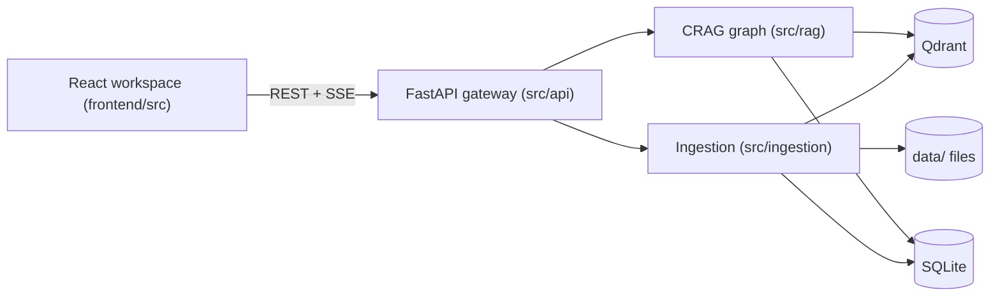

# System Architecture

Single-user, local-first knowledge repository: documents are ingested into a hybrid vector index, and a Corrective RAG (CRAG) graph answers questions with citations back into the source documents.

## Components and owners



| Boundary | Entry point | Responsibility |
|---|---|---|
| Gateway | [`main.py`](../backend/src/api/main.py) (`lifespan`, `create_app`) | Owns lifecycle of every shared resource (SQLite engine, Qdrant client, embedder, reranker, checkpointer, ingestion pool), executes SQLite schema migrations (`init_db`) and Qdrant legacy vector payload backfill (`backfill_qdrant_legacy_payloads`), and mounts the built SPA at `/` when present. |
| HTTP contract | [`routes/`](../backend/src/api/routes/), [`schemas.py`](../backend/src/api/schemas.py) | `/api/v1/documents`, `/api/v1/chat`, `/api/v1/domains`, `/api/v1/lexicon`, `/api/v1/settings` (including `/verify-key`), `/api/v1/system`. The live OpenAPI spec at `/docs` is the authoritative endpoint list. |
| Ingestion & Classification | [`worker.py`](../backend/src/ingestion/worker.py) (`IngestionOrchestrator`) → [`parser.py`](../backend/src/ingestion/parser.py) → [`classifier.py`](../backend/src/ingestion/classifier.py) (`LayaDomainClassifier`) → [`entity_extractor.py`](../backend/src/ingestion/entity_extractor.py) → [`chunker.py`](../backend/src/ingestion/chunker.py) → [`indexer.py`](../backend/src/ingestion/indexer.py) | Parse to Markdown/AST, predict dynamic domain taxonomy from `DomainRegistry` (`convaiinnovations/laya-multilingual` or keyword-boosted classifier) and extract entities, handle Stage 1b human-in-the-loop approval, contextualize chunks with token-bounded headers and custom chunking strategies, embed and upsert hybrid vectors. |
| CRAG engine | [`graph.py`](../backend/src/rag/graph.py) (`build_rag_graph`, `stream_chat_response`), [`retriever.py`](../backend/src/rag/retriever.py), [`reranker.py`](../backend/src/rag/reranker.py) | Graph nodes and routing; dynamic domain pre-analyzer with polysemy lexicon (`DomainLexicon`), federated scatter-gather retrieval across dynamic domain partitions with calibrated RRF (0.5x general fallback discount), soft authority prior tie-breaking ($\alpha=0.08$), and epistemic synthesis with conflict matrix. Conversation state persists via the LangGraph SQLite checkpointer with citations preserved on `AIMessage.additional_kwargs["citations"]`; thread titles/timestamps live in the `chat_threads` table because the checkpointer holds no thread metadata. |
| LLM routing & Credential Boundary | [`llm.py`](../backend/src/rag/llm.py) (`resolve_provider_credential`, `resolve_provider_and_model`, `get_chat_model`, `sanitize_llm_error`) | Unified credential resolution (`UI Key > .env > none`), token masking (<16 char protection), key+base_url hash validation cache, live provider pings, error sanitization, and workspace-level defaults from `WorkspaceSettings`. |
| Persistence | [`db/models.py`](../backend/src/db/models.py), [`db/qdrant.py`](../backend/src/db/qdrant.py), [`db/repository.py`](../backend/src/db/repository.py) | Relational schema (`Document`, `DomainRegistry`, `SubdomainRegistry`, `DomainLexicon`, `WorkspaceSettings`, `CrossDomainEntity`), Qdrant collection + payload indices on `domain` and `subdomain`, atomic deletion and cascade purge or reassignment. |
| Frontend | [`App.tsx`](../frontend/src/App.tsx), [`workspaceStore.tsx`](../frontend/src/lib/workspaceStore.tsx), [`useDomains.ts`](../frontend/src/hooks/useDomains.ts), [`domainTheme.ts`](../frontend/src/lib/domainTheme.ts), [`SettingsModal.tsx`](../frontend/src/components/settings/SettingsModal.tsx), [`ErrorBoundary.tsx`](../frontend/src/components/common/ErrorBoundary.tsx) | Three-pane workspace wrapped with a root error boundary; dynamic domain registry and unified settings modal (with per-provider API key management and live verification); 3 proactive alert surfaces (Settings Tab 3, Chat Composer, Header); static 10-color Tailwind palette; dynamic facet filtering with `+N More ▾` overflow popovers, Stage 1b approval cards & review banners, dynamic domain routing bar, domain-colored citation pills, and interactive citation highlighting. |

> [!TIP]
> For an interactive visual walkthrough of all 7 LangGraph CRAG nodes, execution modes, 3-tier database interactions, and prompt templates, see the [Interactive CRAG Workflow Presentation](presentations/crag_workflow_explained.html) and the high-resolution [CRAG Workflow Architecture Diagram](assets/langgraph-crag-workflow.svg).

## Data flow & Ingestion pipeline

The ingestion engine processes files through a multi-tiered, self-healing pipeline designed for resilience under high batch concurrency:

```mermaid
flowchart TD
    subgraph UI["Frontend UI (React SPA)"]
        DROP[UploadDropzone: Auto / GPU Vision / Fast CPU] -->|Enqueue N Files| CQ["Client Upload Queue (Concurrency=2)"]
        CQ -->|Individual POST /upload?prefer_fast_path| API_UP[FastAPI Upload Router]
        LIB[Knowledge Library: Badges & Upgrades] -->|Action: Retry / Upgrade| API_CTRL[Control Endpoints]
    end

    subgraph GW["Gateway & Routing (FastAPI)"]
        API_UP --> DEDUP{SHA-256 Collision Check}
        DEDUP -->|Duplicate & Same Mode| HIT[Return Cached Doc]
        DEDUP -->|Duplicate & Fast->GPU Upgrade| UPGRADE[Auto-Trigger Re-parse Upgrade]
        DEDUP -->|New File| PRE{Preflight Route / Mode Param}
        PRE -->|Fast CPU / Digital Text| FP["Fast-Path: pymupdf4llm (0.4s, 0MB VRAM)"]
        PRE -->|GPU Vision / Complex Layout| VP["Vision-Path: Docling + TableFormer"]
        UPGRADE --> VP
    end

    subgraph ORCH["Ingestion Orchestrator (worker.py)"]
        FP --> SEM["Semaphore Barrier: max_workers=1"]
        VP --> SEM
        SEM --> POOL[Spawned ProcessPoolExecutor]
        POOL -->|BrokenProcessPool Crash| HEAL[Self-Healing Rebuild & Poison Isolation]
        POOL -->|Stage 1 Layout Complete| CHK[Stage 1 Checkpoint Cached to Disk]
        CHK --> CLAS["Stage 1b: Laya Classifier & Entity Extractor"]
        CLAS --> GATE{Approval Mode Check}
        GATE -->|Needs Review| HOLD["Status: awaiting_approval (Release Semaphore)"]
        HOLD -->|POST /approve-classification| RESUME["Resume Ingestion from Checkpoint"]
        GATE -->|Auto Approved| RESUME
        RESUME --> CHUNK["Stage 2: Contextual Chunking (Prefix Header)"]
    end

    subgraph IDX["Hybrid Indexer (indexer.py)"]
        CHUNK --> BARRIER{Pre-Upsert SQLite Barrier}
        BARRIER -->|Doc Deleted / Cancelled| ABORT[Abort Indexing & Discard]
        BARRIER -->|Doc Valid| PURGE[Pre-Purge Stale Vectors for doc_id]
        PURGE --> BATCH_UP[Batch Upsert to Qdrant with Domain/Subdomain Payload]
        BATCH_UP -->|Upsert Exception| ROLLBACK[Compensating Rollback: Delete Point IDs]
        BATCH_UP -->|Success| COMMIT[Commit Relational SQLite State (domain, subdomain, parsing_engine)]
    end
```

### Fast-Path Preflight Heuristic & Operator Modes
- **Lightweight 5ms Probe**: For PDF uploads in `Auto` mode (`prefer_fast_path=None`), PyMuPDF samples up to 3 pages in-process inspecting character density and embedded image count.
- **Classification Boundary**:
  - `digital_text`: Average $> 120$ characters/page and $\le 2$ embedded images. Routed to `pymupdf4llm` executing sub-second parse with 0 MB GPU VRAM allocation.
  - `scanned_or_heavy_layout`: Sparse text ($\le 120$ characters/page) or dense image scans ($> 2$ images/page). Routed to Docling layout parser + TableFormer with RapidOCR on CUDA.
- **Operator Ingestion Control**: Operators can pre-select explicit modes in the upload dropzone:
  - `⚡ Auto (Recommended)`: Balanced heuristic preflight routing.
  - `🚀 GPU Vision`: Forces Docling v2 + TableFormer on CUDA (~1.8 GB VRAM).
  - `📄 Fast CPU`: Forces `pymupdf4llm` sub-second CPU text extraction (0 MB GPU VRAM).
- **Post-Upload 1-Click Upgrade**: Documents parsed with Fast CPU display an "Upgrade to GPU Vision" action in the Document Inspector header, executing a clean re-parse without losing document ID or relational references.

### Multi-Domain Classification & Human-in-the-Loop Gate
- **Dynamic Taxonomy (Domain & Subdomain Registry)**: Documents belong to top-level domains stored in `DomainRegistry` (seeded with four protected system domains: `engineering`, `economics`, `law`, and `general` fallback, plus 13 hierarchical starter subdomains; extensible up to 10 active top-level domains). Users can dynamically create, edit, or delete custom domains and subdomains at runtime via `/api/v1/domains`. Each domain specifies an epistemic type (`empirical`, `evaluative`, `normative`, `descriptive`, `general`), chunking strategy preset (`standard_markdown`, `academic_equations`, `statutory_clauses`, `financial_tables`), color token (10 static palette values), icon, authority priority ($1\text{–}5$), and classifier keywords. System starter domains (`is_system = True`) lock `slug`, `name`, `epistemic_type`, and deletion while allowing visual, description, keyword, subdomain, and lexicon customization.
- **Unified Workspace Settings**: Global ingestion and AI defaults are managed via the singleton `WorkspaceSettings` table in SQLite (`GET/PATCH /api/v1/settings`), configuring default upload engines (`auto`, `gpu`, `fast`), approval gates (`review_all`, `auto_high_confidence`, `auto_all`), high-confidence threshold ($0.50\text{–}0.99$, default `0.85`), and default LLM provider/model choices without requiring backend restarts.
- **Multilingual Classifier**: Uses `convaiinnovations/laya-multilingual` (`LayaDomainClassifier`) driven by the in-memory `TaxonomyCatalog` to predict domain/subdomain with confidence score ($\in [0.0, 1.0]$) and cross-domain entity flags across English and Vietnamese text without external API calls.
- **Approval Modes**:
  - `review_all` (default): Every uploaded document transitions to `awaiting_approval` after layout parsing and entity extraction. The operator verifies or adjusts the predicted domain/subdomain before vector indexing.
  - `auto_high_confidence`: Documents with classification confidence $\ge$ `high_confidence_threshold` (default `0.85`, configurable in `WorkspaceSettings` or `INGESTION_HIGH_CONFIDENCE_THRESHOLD`) index automatically; lower-confidence documents pause at `awaiting_approval`.
  - `auto_all`: Ingests all documents straight into Qdrant using the predicted classification without human gate interruption.
- **Zero Worker Pool Starvation**: When a document transitions to `awaiting_approval`, `IngestionOrchestrator` releases the ingest semaphore (`_doc_semaphore`) and keeps the parsed AST/Markdown in disk checkpoints. Subsequent files in a batch proceed immediately; approving an awaited document re-queues it for Stage 2 without re-running layout parsing.

## Invariants

- **Content-addressed storage.** A document's identity on disk is its SHA-256; uploads of an already-ingested hash are deduplicated. Artifacts under `data/{raw,parsed,markdown}` are named only from the hash, never from user input.
- **Deletion order is Qdrant → SQLite → files.** A vector purge failure aborts before SQLite is touched, so the document remains visible and retryable instead of leaving orphaned vectors. See `delete_document_atomic`.
- **Parsed AST is a cache.** Expensive layout parsing runs once; re-chunking or re-embedding can reuse `data/parsed/`.
- **Parent context lives in the Qdrant payload.** Retrieval searches small child chunks but feeds parent text to the LLM in one round trip, with no SQLite join.
- **Wire format is snake_case** end to end, including citation objects consumed by the frontend.

### Cross-Stack Consistency Invariants

1. **Content-Addressed Pre-Allocation**: Files stream into `.upload_<uuid>.tmp` while computing SHA-256. If a document with identical hash already exists in SQLite, the temp file is removed and the existing document response is returned (`duplicate=True`). When concurrent duplicate requests collide during creation, SQLite's UNIQUE constraint triggers `IntegrityError`, which rolls back the transaction and returns the existing record with zero HTTP 500 crashes.
2. **Pre-Upsert Relational Barrier**: Before writing chunk point batches to Qdrant in `HybridIndexer.index_chunks()`, the indexer queries SQLite (`session.get(Document, doc_id)`). If the document was deleted via API or cancelled while chunking, indexing immediately aborts with 0 points upserted, preventing ghost vectors in the vector store.
3. **Compensating Rollback Invariant**: If a vector store or network exception occurs mid-indexing (e.g. batch 2 of 4 fails), previously upserted point IDs for that document are purged via compensating `client.delete(points=...)`, restoring clean atomic state. If the rollback itself encounters an outage, point IDs are logged for manual/background reconciliation without masking the primary exception.
4. **Auto-Healing ProcessPool Recovery**: Spawned subprocess crashes (e.g. C-level segfaults on poison PDFs triggering `BrokenProcessPool`) are intercepted by `IngestionOrchestrator`. The dead pool is force-reclaimed, the failing document is marked `failed` with poison diagnostic details, and a fresh executor is lazily re-instantiated for subsequent queued files without crashing the server or stalling the queue.
5. **Graceful Ingestion Pause Barrier**: Ingestion pause via `POST /api/v1/system/ingestion/pause` sets an internal pause flag. The active document completes its pipeline gracefully, while queued tasks hold at `_doc_semaphore` and `_resume_event` without half-indexed state or abrupt teardown.
6. **Compensating Pre-Purge & Deterministic Ingestion Invariance**: When re-indexing or retrying a document, `HybridIndexer.index_chunks` executes a pre-purge: existing Qdrant points matching `doc_id` are deleted before SQLite `DocumentChunk` records are cleared and new batches are upserted. Combined with deterministic UUID5 chunk generation derived from document SHA-256 and chunk index, this guarantees strict vector and chunk count invariance ($N_{\text{after}} = N_{\text{before}}$) across retries.
7. **Atomic Compare-and-Swap (CAS) Concurrency Guard**: Concurrent calls to `POST /documents/{doc_id}/retry` are serialized via an atomic SQL update checking `Document.status.not_in(["parsing", "chunking", "indexing", "queued"])`. If competing requests collide, exactly one succeeds and competing calls receive `HTTP 409 Conflict`.
8. **Real-Time Client Telemetry Synchronization**: The frontend coordinates `useDocuments` and `useSystemStats` polling, auto-refreshing system stats every 2s during active ingestion and invalidating `system-stats` the instant background processing completes.
9. **User-Controlled Ingestion Modes & Invalidation Invariants**:
   - **Mode-Aware Checkpoint Invalidation**: Re-parsing checks the cached AST in `data/parsed/{sha}.json`. If its recorded engine mismatches the requested engine (`prefer_fast_path`), the cached checkpoint is invalidated and bypassed to execute the requested engine.
   - **Duplicate Upload Auto-Upgrade**: Re-uploading a document previously parsed with Fast CPU (`pymupdf4llm`) with GPU Vision (`prefer_fast_path=false`) automatically schedules a background re-parse upgrade and returns `HTTP 202 Accepted` (`duplicate=False`).
   - **Downgrade Protection**: Re-uploading a document previously parsed with GPU Vision (`docling`) in Fast CPU mode is idempotent and protected against accidental downgrade, returning `HTTP 200 OK` (`duplicate=True`). Intentional downgrades require explicit invocation of `POST /documents/{id}/retry` with `force_reparse=true&prefer_fast_path=true`.
   - **Zero-Disk-I/O Relational Attribution**: `Document.parsing_engine` and `Document.engine_fallback_reason` columns are stored directly in SQLite and batch-loaded during `GET /documents`, executing in $< 10\text{ms}$ for 100 items with zero disk I/O.
   - **Transparent Failover Attribution**: When Docling GPU fails (CUDA OOM, crash) in explicit GPU mode or Auto mode, the parser falls back to PyMuPDF CPU and records the diagnostic cause in `engine_fallback_reason`, surfaced to the operator via amber badges without silent disguise and persisted to the `Document.engine_fallback_reason` database column.
   - **Duplicate Upload Upgrade CAS Coalescing**: When a duplicate upload requests an upgrade with `prefer_fast_path=false`, an atomic CAS query updates `Document.status` only if `status.in_(["ready", "failed"])`. If `res.rowcount == 0` (document is actively in-flight: queued, parsing, chunking, or indexing), the request safely coalesces into the in-flight record returning HTTP 200/202 with `duplicate=True` without dispatching redundant background tasks.
10. **Multi-Turn Citation Persistence Invariant**: In LangGraph CRAG synthesis, each `AIMessage` attaches its structured citations via `additional_kwargs["citations"]` (and an explicit empty list `[]` for fallback notices). When conversation thread history is loaded from SQLite checkpoints via `GET /api/v1/chat/threads/{thread_id}`, all previous turns retain their interactive citations, ensuring historical turns do not lose citation metadata upon subsequent turns.
11. **Multi-Domain Payload Indexing & Contextual Prefix Budget**: Each child chunk is prepended with a contextual metadata header (`[Domain: {domain} | Subdomain: {subdomain} | Entities: {entities}]`) bounded to 24–48 tokens within the 256 clean token chunk budget. Qdrant payloads index `domain` and `subdomain` as keyword fields with payload index filters, enabling sub-millisecond facet filtering and partition scoping.
12. **Zero Worker Pool Starvation During Human-in-the-Loop Approval**: When a document transitions to `awaiting_approval`, `IngestionOrchestrator` immediately releases its slot on `_doc_semaphore` and tracks pending approvals in memory (`_pending_approvals`). The worker pool remains 100% available to continue processing subsequent files in the batch queue without deadlock or worker pool starvation.
13. **In-Flight Cancellation on Document Deletion**: Deleting a document via `DELETE /api/v1/documents/{doc_id}` triggers `IngestionOrchestrator.cancel_document(doc_id)`, setting an `asyncio.Event` (`_cancellations[doc_id]`). If the document is currently queued, parsing, or awaiting approval, the pipeline immediately aborts and discards state before the atomic Qdrant purge, SQLite cascade delete, and raw/parsed file removal run.
14. **Federated Retrieval & Soft Authority Prior**: In `auto` query mode, the pre-analyzer evaluates domain intent and polysemy collisions. If cross-domain keywords are detected, the retriever executes a scatter-gather federated search across targeted domain partitions. Results from the `general` domain receive a 0.5x calibrated RRF penalty to eliminate cross-domain bleed, while domain authority priors apply a soft boost ($\alpha=0.08$) to break tie scores in favor of authoritative domain sources without masking high-relevance chunks.
15. **Lifespan Startup Vector Backfill Invariant**: On application startup, `lifespan` in `main.py` invokes `backfill_qdrant_legacy_payloads`. Pre-existing points in `second_brain_knowledge` lacking `domain` or `is_current` payload keys are backfilled to `"general"` and `is_current = True`. This guarantees legacy vectors are discoverable during federated search without requiring manual re-indexing.
16. **Unconstrained Retrieval General Fallback Invariant**: When the CRAG pre-analyzer or user routing bar selects a single specialized domain or unconstrained multi-domain routing, retrieval partitions always preserve the `general` domain partition (calibrated with a 0.5x RRF weight) unless the operator explicitly locks a strict single-domain filter. This eliminates false-negative knowledge gaps where general-domain documents are relevant.
17. **Frontend Hook Invariance & Error Boundary Isolation**: React components must declare all hooks unconditionally at top level. Drawer panels (e.g. `SourcesDrawer` in `ChatAssistant.tsx`) must never place hook calls inside conditional guards. The workspace is wrapped with a root `ErrorBoundary` (`frontend/src/components/common/ErrorBoundary.tsx`), isolating uncaught rendering exceptions to the affected pane with an actionable retry button rather than blanking the whole application.
18. **Cross-Store Domain Mutation Synchronization**: When updating document classification metadata or approving an awaiting document (`worker.py` and `documents.py`), both the SQLite relational row (`primary_domain_id`, `primary_subdomain_id`), the serialized `classification_result` JSON, the child `DocumentChunk` records, and the Qdrant vector payload (`client.set_payload`) must update synchronously to prevent split-brain state where UI filters show one domain while Qdrant vector retrieval filters by another.
19. **Domain Deletion Cascade & Reassignment Invariant**: Custom domain deletion (`DELETE /api/v1/domains/{slug}`) requires a valid `target_domain` (default `"general"`) and optional `target_subdomain`, rejects deletion of `is_system == True` starter domains (`400`) or domains with active in-flight documents (`409`), and executes in strict transactional order: reassign `EntityDomainMapping.domain_id` (deduplicating collisions so `ON DELETE CASCADE` never wipes entity links), update SQLite `Document` rows, scrub/reassign hybrid `section_overrides` in `classification_result` JSON, update `DocumentChunk` rows, `await session.flush()`, update Qdrant payloads (`client.set_payload(..., wait=True)`), and `await session.commit()`. When `re_index=True`, eligible `"ready"` documents with cached parsed checkpoints transition to `status="queued"` with a new `IngestionJob` for background re-chunking. Subdomain deletion is guarded against deleting `general.general` or the last remaining subdomain of any domain.
20. **Unified Workspace Settings Persistence & Live Client Synchronization**: Global ingestion modes (`default_upload_mode`), approval gates (`default_approval_mode`), confidence thresholds (`high_confidence_threshold`), and LLM provider/model defaults (`default_llm_provider`, `default_llm_model`) are persisted in SQLite `WorkspaceSettings` (`GET/PATCH /api/v1/settings`), synced to backend runtime `Settings` on startup and on save, and immediately propagated to `UploadDropzone`, `ChatAssistant`, and `workspaceStore` via TanStack Query cache updates without one-shot initialization locks.
21. **Static Tailwind Color Palette & Dynamic Domain Mapping**: Tailwind v4 static class scanning invariant prevents dynamic class string interpolation (e.g. `bg-${color}-500`). All 10 domain color tokens (`cyan`, `emerald`, `amber`, `rose`, `violet`, `blue`, `teal`, `orange`, `fuchsia`, `slate`) map deterministically through the static lookup dictionary `DOMAIN_COLOR_PALETTE` in `domainTheme.ts`, guaranteeing reliable CSS compilation for badges, pills, borders, and headings across dynamically loaded user domains.
22. **Docker Storage Topology & Direct Host-Mounted SQLite**: `second_brain.db` and `chat_history.db` reside directly on the host in `./data/db` (mounted into `/app/data/db` via `./data:/app/data` with zero volume shadowing), while `second-brain_qdrant_storage` remains a named volume for Qdrant vector storage. On container shutdown, engines execute `PRAGMA wal_checkpoint(TRUNCATE)` to fold `-wal` frames back into the main `.db` files cleanly.
23. **Single Source of Truth for Document Chunks**: SQLite `DocumentChunk` records store structure, metadata, foreign keys, and empty strings for `text` and `parent_content` (saving ~93% SQLite storage), while Qdrant vector point payloads hold the complete `child_text` and `parent_content` as the single source of truth for RAG retrieval and synthesis.
24. **WSL2/9P WAL Host Inspection Rule**: When running Docker Desktop on Windows with WSL2, host inspection tools (DB Browser, CLI, scripts) must open `data/db/*.db` strictly in read-only mode (`?mode=ro`) while the container runs, or perform write operations only when the container is stopped.
25. **Qdrant On-Disk Vector Mapping**: Qdrant collections configure `on_disk=True` for both dense vectors and HNSW indexes, allowing Qdrant to memory-map vectors from disk rather than pinning them in RAM.
26. **LLM Credential Precedence, Invariant Isolation & Secret Sanitization**: UI-configured keys in SQLite `WorkspaceSettings` take precedence over read-only `backend/.env` without mutating container filesystems. `ws.llm_compat_base_url` is isolated strictly to `_OPENAI_COMPATIBLE_PROVIDERS` and never mutates global `runtime_settings.llm.base_url`. Keys shorter than 16 characters are masked to `"••••" + key[-2:]` to protect short local bearer tokens. All chat SSE errors pass through `sanitize_llm_error()` to prevent raw API keys from leaking into client streams, immediately invalidating validation cache on auth failures.
27. **Two-Tier API Key Verification & Invalid Key Persistence**: Instant format validation + 5s bounded live ping (`POST /api/v1/settings/verify-key`) with SSRF filtering (`_validate_safe_base_url`) and anti-exfiltration guards on unsaved base URLs. When `save_if_valid=True`, format-valid keys failing upstream live ping are persisted alongside their sanitized error messages so all 3 UI alert surfaces turn rose immediately until fixed.

## Decision ledger

Key architectural decisions and trade-offs adopted for the system:

| Decision | Why | Rejected |
|---|---|---|
| Docling v2 as the single parser, `pymupdf4llm` as fallback | ML layout + table recovery across all four formats without running two layout engines | Marker (heavy, PDF-only), MarkItDown (lossy on complex layouts) |
| Excel → sheet schema summary + 50-row Markdown windows with repeated headers | Large sheets stay retrievable without one giant lossy table | Whole-sheet Markdown tables; separate structured store |
| Qdrant hybrid (dense BGE-M3 + FastEmbed BM25 on CPU / native learned sparse on CUDA), RRF fusion | Recall on both semantic and exact-term queries across both CPU and GPU setups | ChromaDB (dense only), LanceDB |
| Local `BAAI/bge-m3` embeddings by default | Multilingual corpus (e.g. Vietnamese + English), no per-token cost; OpenAI embeddings stay configurable | Cloud-only embeddings |
| FlashRank `ms-marco-MultiBERT-L-12` reranker | Multilingual; English-only rerankers degrade non-English retrieval | `ms-marco-MiniLM` / `TinyBERT` defaults |
| Grading = score threshold + one batched LLM call | Bounds cost/latency to one extra LLM call per query | Per-chunk LLM grading; threshold only |
| Spawn pool (`max_workers=1`) for parse+chunk; one shared embedder in the main process | Keeps the event loop responsive during compute-heavy parsing while holding only one copy of the ~2 GB embedding model | Embedding inside workers (more RAM per worker) |
| `config.yaml` mounted read-only in Docker; runtime defaults persisted in SQLite `WorkspaceSettings` (`/api/v1/settings`) + per-request overrides | Keeps container filesystem immutable while letting operators persist default upload engine, approval mode, threshold, and LLM provider/model from the UI | Modifying read-only `config.yaml` on disk |
| Bind to `127.0.0.1`, no authentication | Single-user scope is a stated non-goal boundary; avoids LAN exposure of upload/delete | API token; LAN exposure |
| React + Vite SPA served by FastAPI | Citation → document highlight needs rich bidirectional UI; single process, no Nginx | Chainlit / Streamlit |
| LangChain + LangGraph | Matches the owner's existing skills; CRAG fits a state graph | LlamaIndex |
| Dual-target Docker GPU acceleration (`Dockerfile.gpu` + `docker-compose.gpu.yml`) with single-pass fp16 BGE-M3 (dense + learned sparse) and CUDA RapidOCR (`onnxruntime-gpu==1.20.0`) | Delivers `<= 8 GB` VRAM containerized CUDA acceleration for NVIDIA RTX GPUs while keeping default CPU image 100% lightweight (~2.1 GB) with seamless fallback | Monolithic CUDA image (heavy for CPU users); separate FlagEmbedding dependency bloat |
| Adaptive memory (CPU RAM) & GPU VRAM reclaim (`release_cuda_cache()`, `_doc_semaphore`, idle worker reaper, `_reclaim_on_idle`, and telemetry API) | Keeps ~1.8 GB VRAM Docling/RapidOCR worker warm across multi-file batch uploads while automatically reclaiming memory after 60s idle or via `POST /api/v1/system/memory/reclaim`. Restricts CUDA cache flushing to `_active_indexing_jobs == 0` and bounds document intake via `_doc_semaphore` to avoid CUDA allocator thrashing or killing workers mid-document during concurrent uploads. Enables seamless co-existence with local LLMs (e.g. Ollama) on an 8 GB VRAM budget. | Static perpetual worker retention (exhausts VRAM for local LLMs); per-document worker restarts via raw `max_tasks_per_child` (incurs 3.5s Docling reload stall per file/stage); uncoordinated `empty_cache()` mid-embedding |
| Fast-Path PDF Preflight Routing (5ms probe via PyMuPDF) | Automatically routes clean digital text PDFs (>120 chars/page, <=2 images) to `pymupdf4llm` (sub-second parse, 0 MB GPU VRAM) while reserving heavy Docling + TableFormer for scanned/complex documents; user can force Docling via UI retry action. | Heavy Docling for all PDFs (slows throughput on standard text); whole-corpus fallback without preflight probe |
| Resumable Stage Checkpointing (Stage 1 layout cache on disk) | Persists parsed AST (`data/parsed/{sha}.json`) and Markdown (`data/markdown/{sha}.md`), skipping 90%+ of pipeline latency on retry while always re-running chunking & vector indexing. | Checkpointing all stages (invalidates on chunking parameter changes); no checkpointing (forces re-parsing) |
| Client-Side Bounded Upload Queue (Concurrency = 2 in React SPA) | Manages multi-file drops in browser with individual progress bars, failure isolation, failed-file retry triggers, and pause/resume agency without overloading backend semaphore. | Unbounded parallel multi-part POST storm (overwhelms server event loop and triggers refetch cascades) |
| Compensating Pre-Purge & Deterministic UUID5 Chunking on Ingestion Retry | Re-indexing atomically purges prior Qdrant vector points (FilterSelector on `doc_id`) and SQLite `DocumentChunk` rows, combined with deterministic UUID5 chunk generation, guaranteeing exact chunk and vector invariance across retries. | Additive vector insertion (accumulates duplicate chunks and corrupts retrieval scores) |
| Atomic Compare-and-Swap (CAS) Concurrency Guard on Document Retry | Uses atomic SQL status update (`status.not_in(["parsing", "chunking", "indexing", "queued"])`) to serialize concurrent retry requests at database level; competing requests receive HTTP 409 Conflict. | In-memory Python status checks (vulnerable to TOCTOU races and duplicate background worker dispatches) |
| User-Controlled Ingestion Modes (Auto vs. GPU Vision vs. Fast CPU) with Zero-Disk-I/O State Attribution | Gives operators deterministic control over GPU VRAM allocation vs parsing fidelity, auto-upgrades duplicate uploads, protects against accidental downgrades, and exposes parsing state in $< 10\text{ms}$ SQL listings without disk reads | Pure heuristic routing without operator choice; disk reads on listing; silent fallback disguises |
| Atomic CAS Coalescing on In-Flight Duplicate Upgrades | Re-uploading a document requesting a mode upgrade while in-flight atomically coalesces into the active job with `duplicate=True` and HTTP 200/202 | HTTP 409 Conflict rejection; launching concurrent worker processes |
| Uniform Multi-Turn Citation State (`additional_kwargs["citations"]`) | Explicit `additional_kwargs["citations"]` on all assistant messages (including `[]` on fallback notices) guarantees citations are preserved across thread history checkpoints | Leaving historical messages without citation metadata; losing citations on thread reloads |
| Single multilingual classifier (`convaiinnovations/laya-multilingual`) | Compact transformer model with native Vietnamese and English classification running in-process; avoids multi-model latency or external API cost | Dual separate language routers; cloud-only LLM-based classification |
| Epistemic Triad taxonomy (`engineering`, `economics`, `law`, `general`) | Decouples normative rules (law), cost/incentives (economics), and mechanism/implementation (engineering) into distinct knowledge partitions without overlapping schemas | Unstructured flat tag soup; fine-grained unmanageable ontology |
| Contextual chunk prefixing with fixed 256 clean token budget | Prepends domain, subdomain, and extracted entities into chunk text for embedding and LLM context while reserving 256 clean tokens for body text | Separate metadata injection at retrieval time; unrestricted prefix dilation |
| Bilingual polysemy lexicon with SQLite idempotent seeding | Seeds 20 dual-meaning terms in SQLite (`DomainLexicon`) to detect cross-domain polysemy collisions during pre-analysis and federate retrieval cleanly | Hardcoded regex lists; ignoring language polysemy |
| Adaptive epistemic synthesis with conflict matrix layout | Formats multi-domain query answers with distinct domain perspectives and a structured comparative conflict table | Monolithic blended answers that obscure domain disagreements |
| Startup legacy payload backfill in `lifespan` | Automatically backfills pre-existing Qdrant vectors with `"domain": "general"` and `"is_current": true` on boot | Requiring manual collection re-embedding or CLI migration scripts |
| Preserving general domain fallback during single/unconstrained routing | Retains a 0.5x-discounted general partition candidate pool so general-classified documents remain retrievable | Hard domain siloing that drops relevant general knowledge |
| Root React ErrorBoundary & strict hook ordering | Wraps workspace in an ErrorBoundary and enforces unconditional top-level hook declarations, preventing React hydration or render crashes | Allowing uncaught child exceptions to blank out the entire workspace |
| Dynamic Domain Registry with SQLite Persistence & System Starter Protection | Relational domain models (`DomainRegistry`, `SubdomainRegistry`) with protected system starter domains allow flexible user taxonomy while preserving core epistemic foundation | Static enum / hardcoded constants in codebase |
| Unified Workspace Settings Table | Single-row `WorkspaceSettings` SQLite table gives operators unified control over ingestion engine, approval mode, confidence threshold, and LLM defaults without service restarts | Modifying read-only `config.yaml` or scattered localStorage configs |
| Static 10-Color Tailwind Dictionary & Dynamic Resolver | Compile-time static class dictionary (`DOMAIN_COLOR_PALETTE`) with runtime lookup (`resolveDomainMeta`) guarantees full Tailwind v4 class generation | Dynamic interpolation like `bg-${color}-500` which fails CSS compilation |
| Inline Starter Pills with `+N More ▾` Overflow Popover | Maintains clean, compact chat routing and library facet bars by showing starter domains inline while collapsing unlimited custom domains into an accessible popover | Unbounded horizontal scroll or wrapping pill walls |
| Direct host-mounted SQLite (`./data/db`) with clean shutdown WAL truncation | Moves SQLite databases out of hidden Docker named volumes directly onto the host filesystem for zero volume shadowing and transparent host file-level backups | Storing databases inside named volumes or running separate DBMS servers (e.g. Postgres) |
| Chunk text deduplication (Qdrant payload as single source of truth) | Keeps child and parent chunk text in Qdrant point payloads only, writing empty strings to SQLite `DocumentChunk` rows while preserving foreign keys and schema contracts; shrinks `second_brain.db` from 30 MB to ~2 MB | Storing multi-megabyte duplicated chunk text strings in both SQLite and Qdrant |
| LangGraph Checkpoint Compaction & Idle-Gated SQLite VACUUM | Clears transient retrieved/reranked/graded chunk lists on node transitions, compacts superseded intermediate CRAG checkpoints, and runs autocommit `VACUUM` during `POST /api/v1/system/memory/reclaim` when workers are idle | Retaining multi-megabyte raw chunk arrays across every intermediate checkpoint turn; uncoordinated VACUUM during active ingestion |
| Qdrant `on_disk=True` for dense vectors and HNSW index | Reduces Qdrant RAM consumption by memory-mapping vector data and graph indexes directly from disk | Pinning all vector embeddings and HNSW graphs in RAM |
| HuggingFace cache unification under `models/huggingface/hub` | Normalizes all embedder and sparse weight downloads to `models/huggingface/hub` (matching `HF_HOME`), preventing duplicate 4+ GB blob downloads at the cache root | Allowing `SentenceTransformer(cache_folder=...)` to download duplicate model copies outside `hub/` |
| UI-Configured LLM Credentials in SQLite `WorkspaceSettings` with Read-Only `.env` Fallback & Two-Tier Validation | Preserves read-only container filesystem security (`backend/.env:ro`) while allowing operators to configure, mask, verify, or clear keys live with 0ms polling overhead and proactive warnings across 3 UI surfaces | Mutating `backend/.env` from inside Docker; unverified key saves causing silent runtime chat failures; storing plaintext credentials in client browser storage |

## Non-goals

Not multi-user or collaborative, not a document editor (ingestion is read-only), not a general assistant outside the curated corpus, and no requirement for local GPU or local LLM inference.

## Known constraints

- `pymupdf4llm` is AGPL-licensed — acceptable for personal self-hosting; revisit before redistribution.
